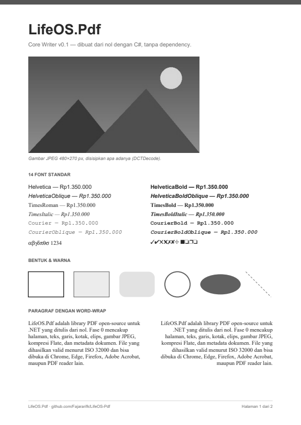

# LifeOS.Pdf

Library PDF open-source untuk .NET, **ditulis dari nol** dengan C#, tanpa
dependency. Jalan di **.NET Standard 2.0, .NET 5, 6, 7, 8, 9, dan 10**
(dan .NET Framework 4.6.1+ lewat netstandard2.0).

File yang dihasilkan divalidasi dengan qpdf, pypdf, dan PDFium (engine di
balik PDF viewer Chrome), jadi bisa dibuka di Chrome, Edge, Firefox, Adobe
Acrobat, maupun PDF reader lain.

<p align="center"></p>

## Status

| Fase | Isi | Status |
|---|---|---|
| 0 | Core writer: halaman, teks 14 font standar, bentuk, JPEG, kompresi, metadata | ✅ v0.1 |
| 1 | Font TrueType + Unicode, PNG, gambar → PDF | berikutnya |
| 2 | Layout engine: paragraf, tabel multi-halaman, header/footer | rencana |
| 3 | Laporan dari template (invoice, slip gaji, laporan keuangan) | rencana |
| 4 | Buat QR & barcode (vektor, PNG, SVG) | rencana |
| 5 | Link, bookmark, lampiran, anotasi | rencana |
| 6 | Buka PDF, merge, split, watermark, kompres | rencana |
| 7 | Ekstrak teks, gambar, tabel (CSV) | rencana |
| 8 | Form: buat, isi, flatten | rencana |
| 9 | Enkripsi & tanda tangan digital | rencana |
| 10 | Render ke gambar, baca QR/barcode, OCR (package terpisah) | rencana |
| 11 | HTML → PDF (wkhtmltopdf & Chromium, package terpisah) | rencana |
| 12 | PDF/A, PDF/UA, gradien, layer, e-invoice | rencana |

Detail tiap fase dan pemetaan use case ada di [docs/PHASES.md](docs/PHASES.md).

## Contoh

```csharp
using LifeOS.Pdf;
using LifeOS.Pdf.Drawing;
using LifeOS.Pdf.Fonts;
using LifeOS.Pdf.Images;

var doc = new PdfDocument();
doc.Info.Title = "Laporan Bulanan";

var page = doc.AddPage(PageSize.A4);
var g = page.Graphics; // titik (0,0) di kiri-atas, satuan point (1/72 inch)

g.DrawText("Halo dunia", new PdfFont(StandardFont.HelveticaBold, 24), 72, 72);
g.DrawTextBox("Paragraf panjang otomatis dipotong per baris sesuai lebar kotak.",
    new PdfFont(StandardFont.TimesRoman, 12), 72, 120, width: 300);
g.DrawRoundedRectangle(new PdfPen(PdfColor.Blue, 1), PdfColor.FromHex("#DBEAFE"), 72, 200, 200, 60, radius: 8);
g.DrawText("Rp1.350.000", new PdfFont(StandardFont.Courier, 12), 272, 220, align: TextAlign.Right);
g.DrawImage(PdfImage.FromFile("foto.jpg"), 72, 300, width: 250); // tinggi mengikuti rasio

doc.Save("laporan.pdf");
```

Contoh lengkap ada di [samples/LifeOS.Pdf.Samples](samples/LifeOS.Pdf.Samples/Program.cs).

## Build & test

Butuh .NET SDK 8 atau lebih baru (SDK 10 juga membangun target `net10.0`).

```bash
dotnet build -c Release
dotnet test -c Release
dotnet run --project samples/LifeOS.Pdf.Samples -f net8.0 -- out/net8.0
```

Validasi eksternal (Python 3.10+):

```bash
pip install pikepdf pypdf pypdfium2
python tools/validate_pdf.py out/net8.0/showcase.pdf --render-dir out/png
```

## Cara pengembangan

Repo ini memakai alur kerja yang sama dengan LifeOS:
**analyst → architect → developer → qa**, satu fase per rilis. Aturan proyek
ada di [CLAUDE.md](CLAUDE.md), peran agent di [.claude/agents](.claude/agents),
dan playbook tiap fase di [docs/PHASES.md](docs/PHASES.md).

## Lisensi

[MIT](LICENSE). Kode ditulis berdasarkan spesifikasi ISO 32000, tidak
menyalin dari library berlisensi AGPL atau proprietary. Lihat
[THIRD_PARTY_NOTICES.md](THIRD_PARTY_NOTICES.md).
