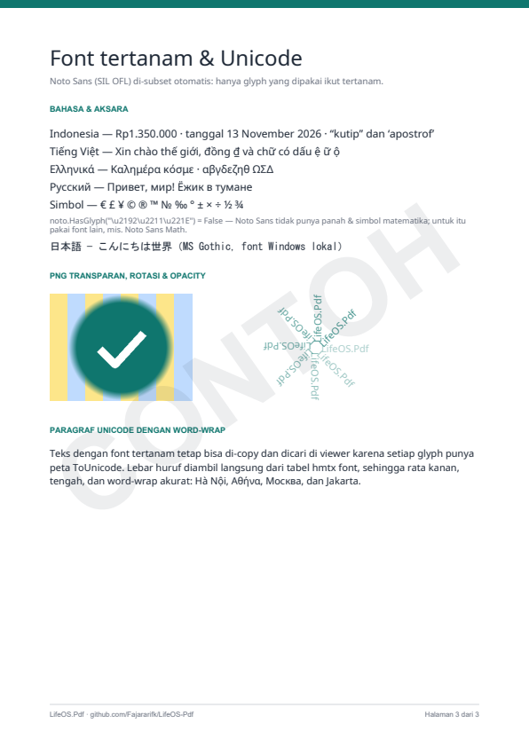
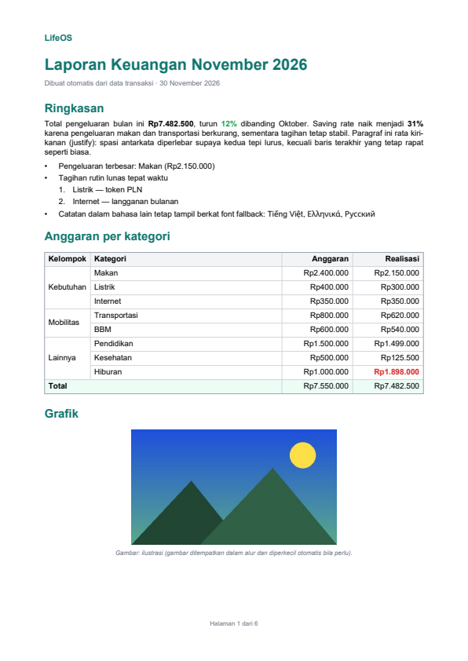
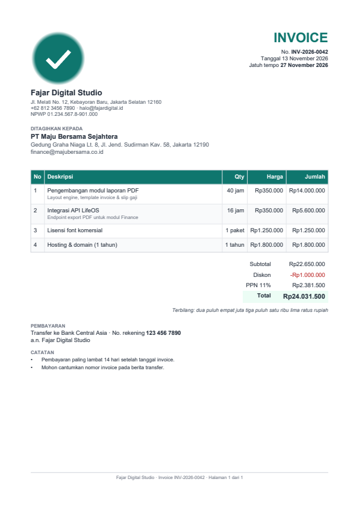

# LifeOS.Pdf

An open-source PDF library for .NET, **written from scratch** in C#. The **core
package has no dependencies** and runs on **.NET Standard 2.0 and .NET 5, 6, 7,
8, 9 and 10** (and .NET Framework 4.6.1+ through netstandard2.0). The optional
companion packages (digital signatures, rendering, barcode scanning, OCR) are
published separately and may use native libraries.

In development, every generated file is validated with qpdf, pypdf and PDFium
(the engine behind Chrome's PDF viewer), and embedded fonts with fontTools and
OTS (the font sanitizer used by Chrome and Firefox), so output opens in Chrome,
Edge, Firefox, Adobe Acrobat and other PDF readers.

<p align="center">
  
  
  
  
</p>

## Installation

```bash
dotnet add package LifeOS.Pdf
```

The core package is **100% managed code with no dependencies** and needs nothing
else on a developer machine or a server, so it runs on Linux, Windows, macOS,
Docker and serverless hosts alike. Optional companion packages (Phase 9–10) are
installed separately and may use native libraries:

```bash
dotnet add package LifeOS.Pdf.Signing          # digital signatures (.NET 8+)
dotnet add package LifeOS.Pdf.Rendering        # PDF → PNG (PDFium)
dotnet add package LifeOS.Pdf.Barcode.Scanning # read QR/barcodes (zxing-cpp)
dotnet add package LifeOS.Pdf.Ocr              # OCR (Tesseract)
dotnet add package LifeOS.Pdf.Scanning         # render + barcode + OCR
```

## Usage

Read the **[step-by-step tutorial](docs/tutorial.md)** — one runnable example for every
feature, from your first PDF to forms, encryption and scanned documents.

## Status

| Phase | Scope | Status |
|---|---|---|
| 0 | Core writer: pages, text in the 14 standard fonts, shapes, JPEG, compression, metadata | ✅ v0.1 |
| 1 | TrueType fonts with full Unicode, transparent PNG, image → PDF, rotation & opacity | ✅ v0.2 |
| 2 | Layout engine: paragraphs, multi-page tables, header/footer, kerning, font fallback | ✅ v0.3 |
| 3 | Reports from templates (invoice, receipt, payslip, finance report, certificate) | ✅ v0.4 |
| 4 | QR codes & barcodes (vector, PNG, SVG), QRIS | ✅ v0.5 |
| 5 | Links, bookmarks, table of contents, attachments, annotations | ✅ v0.6 |
| 6 | Open existing PDFs: merge, split, watermark, page numbers, n-up, compress | ✅ v0.7 |
| 7 | Extract text, images and tables (CSV/JSON), search, PDF → HTML, true redaction | ✅ v0.8 |
| 8 | Forms: create, fill, flatten | ✅ v0.9 |
| 9 | Encryption (password) & digital signatures | ✅ v1.0 |
| 10 | Render to images, read QR/barcodes, OCR (separate packages) | ✅ v1.1 |
| 11 | HTML → PDF (wkhtmltopdf & Chromium, separate package) | planned |
| 12 | Office → PDF: Excel/CSV, Word, PowerPoint; Word templates (mail merge) — separate package | planned |
| 13 | Vector charts, Markdown → PDF, PDF tables → Excel | planned |
| 14 | PDF/A, PDF/UA, gradients, layers, e-invoicing | planned |

The full roadmap and use-case mapping is in [docs/PHASES.md](docs/PHASES.md).

## Build & test

Requires the .NET SDK 8 or newer (SDK 10 also builds the `net10.0` target).

```bash
dotnet build -c Release
dotnet test -c Release
dotnet run --project samples/LifeOS.Pdf.Samples -f net8.0 -- out/net8.0
```

Benchmarks (numbers and what was optimized: [docs/performance.md](docs/performance.md)):

```bash
dotnet run -c Release --project benchmarks/LifeOS.Pdf.Benchmarks
```

External validation (Python 3.10+, development only — not needed to use the library):

```bash
pip install pikepdf pypdf pypdfium2 fonttools opentype-sanitizer
python tools/validate_pdf.py out/net8.0/showcase.pdf --render-dir out/png
```

## Further reading

- **[Step-by-step tutorial](docs/tutorial.md)** — the full walkthrough with runnable examples.
- [docs/PHASES.md](docs/PHASES.md) — full roadmap and use-case mapping.
- [docs/templates.md](docs/templates.md) — the template language reference.
- [samples/LifeOS.Pdf.Samples](samples/LifeOS.Pdf.Samples/Program.cs) — a sample app with
  every feature.

## How it is developed

Each phase goes through **analyst → architect → developer → QA**, one phase per
release. Project rules are in [CLAUDE.md](CLAUDE.md), the agent roles in
[.claude/agents](.claude/agents), and the per-phase playbook and documents in
[docs/](docs/PHASES.md) (internal documents are written in Indonesian).

## License

[MIT](LICENSE). The code is written from the ISO 32000 specification and does
not copy from AGPL-licensed or proprietary libraries. See
[THIRD_PARTY_NOTICES.md](THIRD_PARTY_NOTICES.md).
